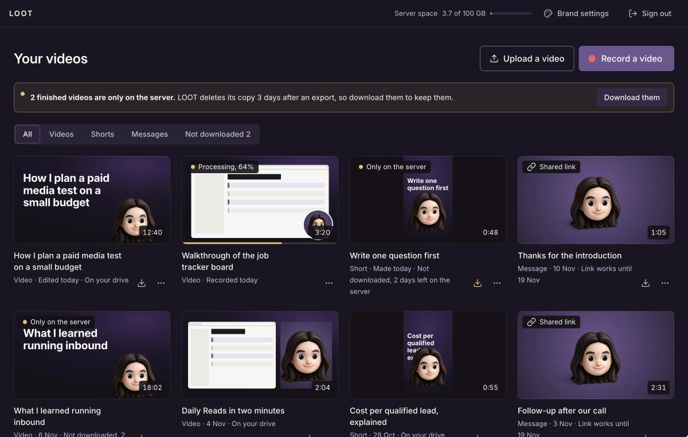
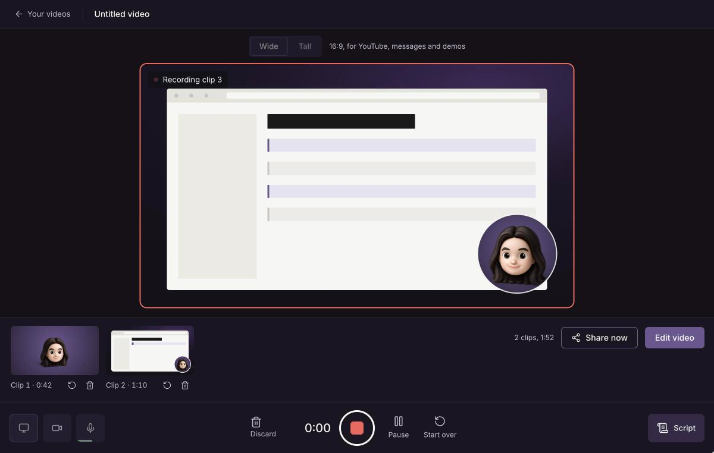
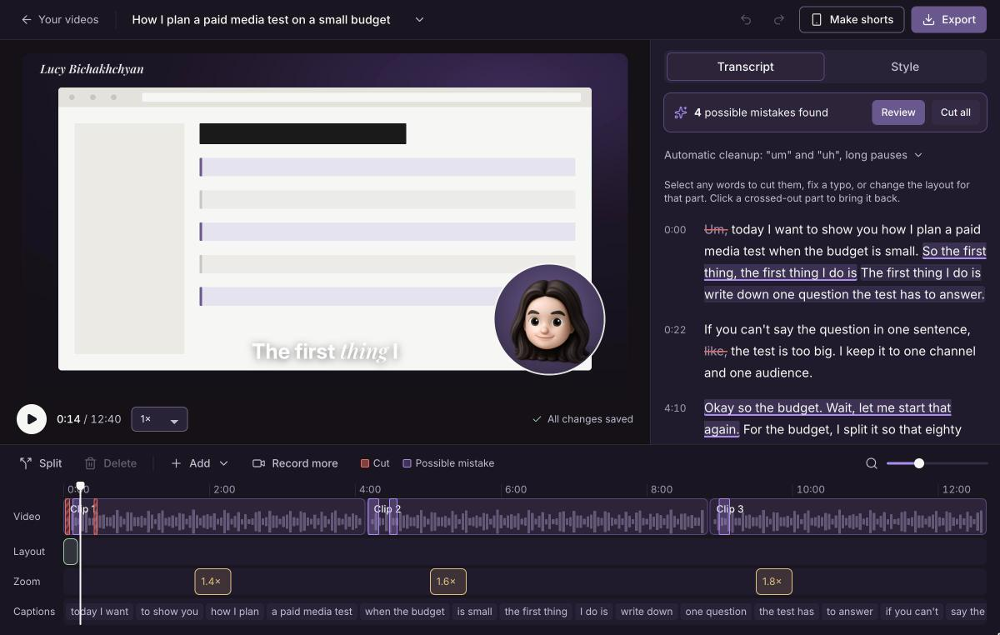
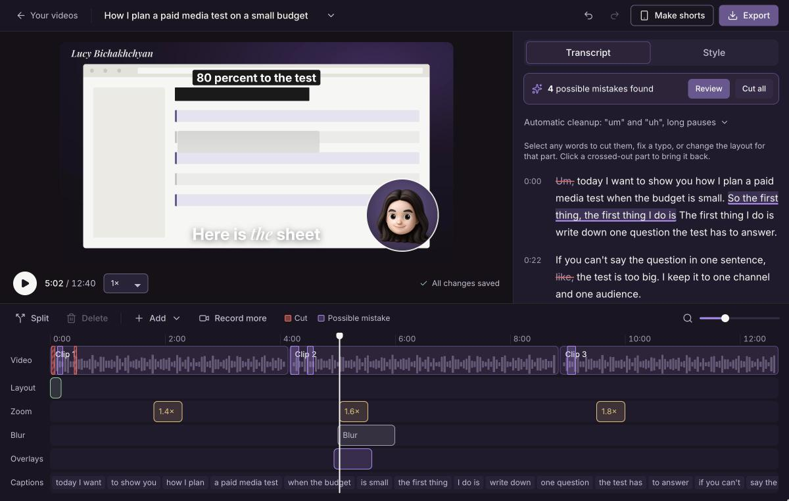
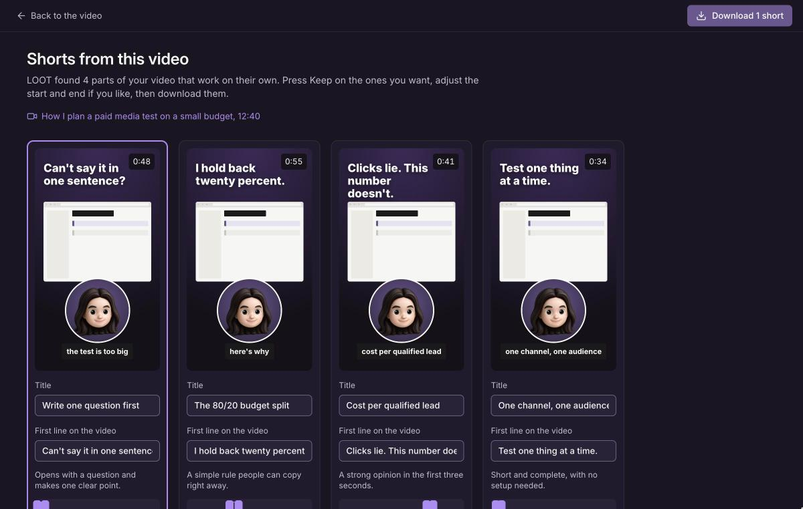
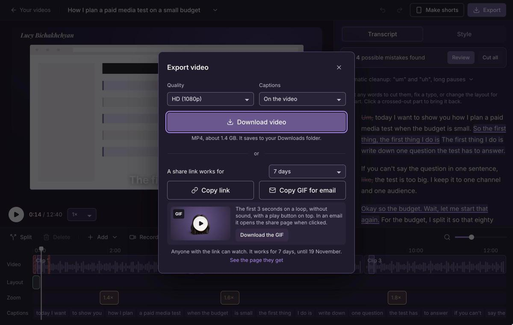
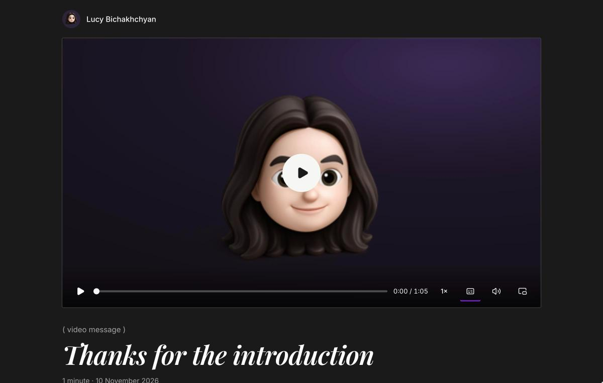
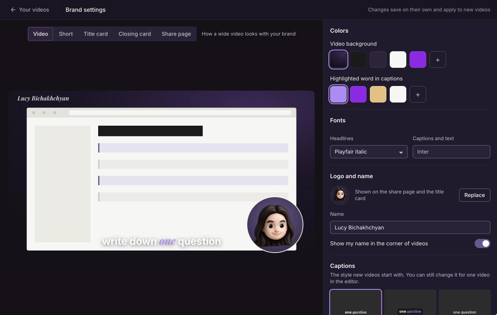

# LOOT

LOOT is a web app for recording your screen and camera, editing the recording by editing its transcript, and sharing or exporting the result. It is a Loom alternative that runs on a server you own, so your videos, your brand and your share links stay with you.

I built LOOT for my own videos: long YouTube videos, shorts cut from them, quick video messages and product demos. My own copy runs at `loot.bichakhchyan.com`, and the code here is the same code that runs there. You are welcome to fork it and run your own.

**[Try the clickable demo](https://lucybichakhchyan.github.io/loot/)**: every screen, with sample content, in your browser and with nothing to install. The [list of screens and moments](https://lucybichakhchyan.github.io/loot/states.html) opens each state directly, such as an export in progress or a share link.

The screenshots below come from the clickable demo, so they show sample content.

## What it does

**Record**
- Record your screen, your camera, or both, in the browser, in clips you can watch, retake or delete.
- Choose a wide (16:9) or tall (9:16) video before you start.
- Read from a teleprompter that scrolls your script and marks the paragraph you are on. A small floating controller lets you pause, stop or open the script without leaving the tab you are recording.
- Upload a video file instead of recording.
- Press Share now after recording to get a link at once. LOOT prepares and exports the video by itself, and the page behind the link fills in when it is ready.

**Edit**
- Cut the video by cutting words in the transcript. "Um", "uh" and long pauses are removed automatically, and Claude points out retakes and false starts for you to review.
- Fix a typo in the captions without cutting the video.
- Split and trim clips on the timeline, and undo anything.
- Switch between four layouts (camera bubble, side by side, camera only and screen only) for the whole video or for any part of it, with a cut or a smooth fade.
- Add zooms that point at a spot you click, blur private details on your screen recording, crop the screen recording, and place text or images on the video.
- Add a title card at the start and a closing card at the end.
- Get a title, a description and YouTube chapters that Claude writes from the transcript.

**Sound**
- Every recording gets noise removal and volume levelling to YouTube's level, and you can compare the original and the cleaned sound.

**Shorts**
- Claude suggests the parts of a long video that work on their own. You keep, trim or skip each one and download them as upright 1080 by 1920 videos with captions.

**Share and export**
- Export an MP4 at 1080p or 720p, with captions on the video or as a separate file.
- Share a link that works for 1 day, 7 days, 30 days or until you turn it off. The viewer's page carries your name, logo, colors and a button of your choice.
- Copy a GIF for email: the first 3 seconds with a play button, which opens the share page when clicked.
- The server deletes its copy of a video 3 days after export, so your videos live on your own drive.

**Brand settings**
- Set your name, logo, colors, headline font, caption style, closing line and share-page button once. Every new video and the share page start from them.

## How it works

- `app/` is the web app, written with FastAPI. `app/main.py` is the server, `app/pages/` holds the pages, and `app/static/js/` holds the browser code.
- `engine/` holds the processing steps. FFmpeg converts, cuts and renders the video. DeepFilterNet removes background noise. Whisper (faster-whisper) writes a transcript with a time for every word. Claude reads the transcript to suggest cuts, shorts, titles, descriptions and chapters.
- Code does everything that has a right answer, such as timings, lengths, loudness and file clean-up. Claude only does what needs judgement, and code checks every answer before it is used. Claude's answers are saved, so it is never asked twice about the same transcript. A video costs cents in Claude use.
- `automation/` holds the background jobs as Swamp workflows: preparing clips, processing, exporting, shorts, a nightly clean-up and a morning health check. Swamp is optional: without it, LOOT runs the same steps directly.
- `design/` holds the approved mockups and design tokens the screens were built from. They are also the clickable demo, which GitHub Pages publishes from this folder. The app serves its own copy of the styles in `app/static/`.
- `docs/screenshots/` holds the pictures in this README.
- `tools/` holds one-time scripts that turned the first mockups into pages. They are kept for reference and are not needed to run LOOT.

## How I host mine

I host LOOT on a Hostinger VPS, the KVM 2 plan, which has 2 CPU cores and 8 GB of memory. The server already ran Docker and Traefik from Hostinger's n8n template, so LOOT went in as one more container next to n8n, and Traefik gave it its web address and HTTPS. The setup was easy: a subdomain pointed at the server, a settings file, and one deploy command.

On a server without a graphics card, preparing a clip takes about as long as the clip itself, and an export of a few minutes of video takes a few minutes.

## Run your own

You need a Linux server with Docker, a domain or subdomain that points to the server, and a reverse proxy for HTTPS. A Claude API key is optional, but without it LOOT does not suggest cuts, shorts or titles.

1. Fork or clone this repository.
2. On the server, create a folder for LOOT, for example `/docker/loot`.
3. In that folder, create a file named `.env` with your settings (see the list below). Never commit this file.
4. On your computer, add an SSH shortcut for the server to `~/.ssh/config`. The deploy script uses a shortcut named `loot` and the folder `/docker/loot` unless you set `LOOT_SSH` and `LOOT_DIR`.
5. Run `./deploy.sh`. It copies the project to the server and builds and starts the container.
6. Open your domain, sign in with your password, and fill in Brand settings with your name, logo, colors and closing line.

The included `docker-compose.yml` expects Traefik with an entry point named `websecure` and a certificate resolver named `letsencrypt`, which is how Hostinger's Docker templates set it up. If you use another proxy, remove the `labels` and publish port 8000 instead, for example with `ports: ["127.0.0.1:8000:8000"]`, and point your proxy at it.

### Settings in `.env`

| Setting | What it does |
| --- | --- |
| `LOOT_DOMAIN` | The web address LOOT runs at, such as `video.example.com`. Required. |
| `LOOT_PASSWORD` | The password for signing in. Required. |
| `LOOT_SECRET` | A long random string that signs the login cookie. Without it, everyone is signed out whenever the container restarts. |
| `ANTHROPIC_API_KEY` | Your Claude API key. Without it, the steps that use Claude are skipped. |
| `LOOT_OWNER_NAME` | Your name, used until you set one in Brand settings. |
| `LOOT_KEEP_DAYS` | How many days the server keeps a video after export. The default is 3. |
| `LOOT_TZ` | The time zone for the nightly clean-up and the morning check. The default is `America/Chicago`. |
| `LOOT_MAX_UPLOAD_GB` | The largest file you can upload. The default is 4. |
| `SWAMP_API_KEY`, `SWAMP_SIGNIN_TOKEN` | Optional. They let the background jobs run as Swamp workflows. |

## Making it yours

Brand settings, inside the app, hold everything personal: your name, logo, colors, fonts, closing line and the button on the share page. Nothing personal is built into the code. Until you upload a logo, LOOT shows a neutral placeholder picture.

To change how the app itself looks, edit the colors and fonts in `app/static/tokens.css`.

## Ideas for later

These were planned and set aside for a later version:
- Shorts whose upright crop follows your face.
- Starting templates for a long video, a short and a video message.
- Interactive click-through product demos, with a Chrome extension that also makes zoom on clicks possible.
- Viewer analytics, an embeddable player, caption translation and 4K export.

## Versions

Each deployed version has a git tag, such as `v1.0.0`. [CHANGELOG.md](CHANGELOG.md) says in plain words what changed in each version.

## Licence

LOOT is released under the MIT licence, in [LICENSE](LICENSE). You may copy, change and reuse it, as long as the licence notice stays with it.
